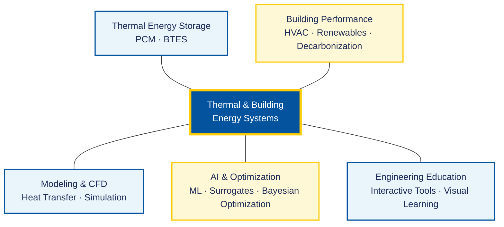

### Researcher · Educator · Engineering Tool Builder

**Assistant Professor · Embry-Riddle Aeronautical University**

I connect **physics-based simulations**, **thermal and building systems**, and **artificial intelligence** to create practical research and interactive engineering tools.

---

## Research Network

## Featured Research

| Research area | Focus |
|---|---|
| **AI-Guided BTES Optimization** | Combining TRNSYS simulation, machine-learning surrogates, and Bayesian optimization to improve solar-assisted borehole thermal energy storage systems |
| **PCM Thermal Energy Storage** | Numerical and experimental investigation of phase-change materials for efficient thermal storage and heat-transfer enhancement |
| **Building Performance & HVAC** | Physics-based modeling of building energy systems, HVAC performance, renewable integration, and decarbonization strategies |

## Teaching & Open Courseware

| Course | Focus |
|---|---|
| **[Python for Mechanical Engineers](https://github.com/nuhaaljuneidi/python-for-mechanical-engineers)** | Six project-based Colab sessions covering engineering calculations, data analysis, visualization, machine learning, simulation, and optimization |
| **[Post-CFD Analysis with Python](https://github.com/nuhaaljuneidi/post-cfd-analysis-with-python)** | Six application-driven sessions for validating, automating, interpreting, and communicating CFD results |

Both courses run in Google Colab and are designed for students, researchers, and practicing engineers.

## Explore My Engineering Tools

Interactive, browser-based tools for teaching and research. No installation needed.

### Dynamics

| Tool | What it does |
|---|---|
| **[Chapter 13 Decision Map](https://nuhaaljuneidi.github.io/dynamics-chapter13-decision-map/)** | Choose a particle-kinematics method: straight-line, curvilinear, or relative motion |
| **[Chapter 14 Decision Map](https://nuhaaljuneidi.github.io/dynamics-chapter14-decision-map/)** | From free-body diagram to Newton's second law in the right coordinates |
| **[Chapter 17 Decision Map](https://nuhaaljuneidi.github.io/dynamics-chapter17-decision-map/)** | Rigid-body kinematics: relative velocity, instantaneous center, relative acceleration |
| **[Chapter 17 Animations](https://nuhaaljuneidi.github.io/dynamics-chapter17-animations/)** | Animated rigid-body motion, instantaneous centers, rolling, and worked problems |
| **[Chapter 18 Decision Map](https://nuhaaljuneidi.github.io/dynamics-chapter18-decision-map/)** | Rigid-body kinetics: translation, fixed-axis rotation, general plane motion |
| **[Dynamics in Motion](https://nuhaaljuneidi.github.io/dynamics-in-motion/)** | Six interactive activities, from displacement to n-t vs. polar coordinates |

### Thermodynamics

| Tool | What it does |
|---|---|
| **[Watching Water Boil](https://nuhaaljuneidi.github.io/watching-water-boil/)** | Constant-pressure boiling traced live on the T–v diagram |
| **[Polytropic Compression Lab](https://nuhaaljuneidi.github.io/thermodynamics/)** | Same start, different polytropic paths: compare boundary work |
| **[Two Paths, Same States](https://nuhaaljuneidi.github.io/thermodynamics/two-paths.html)** | Work and heat depend on the path, not just the end states |
| **[Thermo Infinity Quiz](https://nuhaaljuneidi.github.io/thermo-infinity-quiz/)** | Assigned property cases plus unlimited practice |
| **[Ideal Gas Infinity Quiz](https://nuhaaljuneidi.github.io/ideal-gas-infinity-quiz/)** | Δh and Δu of an ideal gas by two methods, with unlimited practice |

### Heat Transfer

| Tool | What it does |
|---|---|
| **[Heat Transfer Boundary Conditions](https://nuhaaljuneidi.github.io/ht_interactive_tool/)** | 1-D steady conduction under six boundary-condition cases |
| **[The Mystery of h](https://nuhaaljuneidi.github.io/mystery_of_h/)** | Why the convection coefficient depends on the whole flow situation |
| **[Thermal Properties Visualization](https://nuhaaljuneidi.github.io/thermal-tool/)** | k, ρ, c_p, and diffusivity through a meeting-room analogy |
| **[Steady-State vs Transient Detective](https://nuhaaljuneidi.github.io/steady_state_vs_transient_detective/)** | A game for spotting when ∂T/∂t = 0 |

### Building Science & HVAC

| Tool | What it does |
|---|---|
| **[Thermal Assembly Designer](https://nuhaaljuneidi.github.io/R/)** | R-value, U-value, heat loss, and temperature profile of envelope layers |
| **[Thermal Mass & Insulation Simulator](https://nuhaaljuneidi.github.io/inside_vs_outside_insulation-1-/)** | Exterior vs. interior insulation in a transient two-node model |
| **[Psychrometric Analysis Workbench](https://nuhaaljuneidi.github.io/sbed_humidity_calculator/)** | Humidity properties from dry-bulb and dew-point temperatures |
| **[The Three Thermometers](https://nuhaaljuneidi.github.io/The-Three-Thermometers/)** | Dry-bulb, wet-bulb, and dew-point temperatures explained |
| **[Indoor Pool Load Calculator](https://nuhaaljuneidi.github.io/indoor-pool-load-calculator/)** | Evaporation rate and surface load of an indoor pool, SI and IP |
| **[Building Science Teaching Tool](https://nuhaaljuneidi.github.io/Thermal-Image/)** | Heat flow in buildings and what an IR camera reveals |
| **[Energy3D Electricity Cost Calculator](https://nuhaaljuneidi.github.io/AE_bill/)** | Turns Energy3D results into an electricity bill by state |
| **[Make This Classroom Work](https://nuhaaljuneidi.github.io/AE_Engineering-/)** | Outreach activity on the systems that keep a classroom comfortable |

### CFD & Research

| Tool | What it does |
|---|---|
| **[Mesh Strategy by Physics Type](https://nuhaaljuneidi.github.io/mesh/)** | Same geometry, different physics, different mesh |
| **[CFD Meshing Mistakes](https://nuhaaljuneidi.github.io/mesh/mistakes/)** | Seven common meshing mistakes with live before/after views |
| **[Cold Plate Geometry](https://nuhaaljuneidi.github.io/cold-plate-geometry/)** | Interactive 3D view of a competition cold plate and its water path |
| **[LaTeX Field Guide](https://nuhaaljuneidi.github.io/latex-guide/)** | A practical LaTeX path for reports and papers, with an equation playground |
| **[How I Use AI in Academia](https://nuhaaljuneidi.github.io/AI/)** | AI in teaching, research, and engineering work |

### From simulation to insight—and from insight to usable engineering tools.

